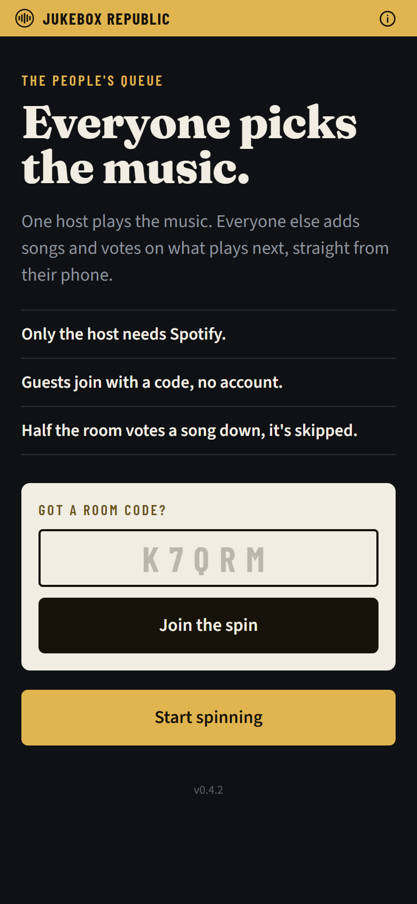
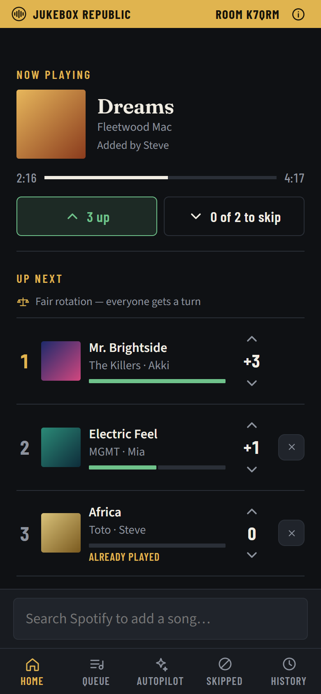
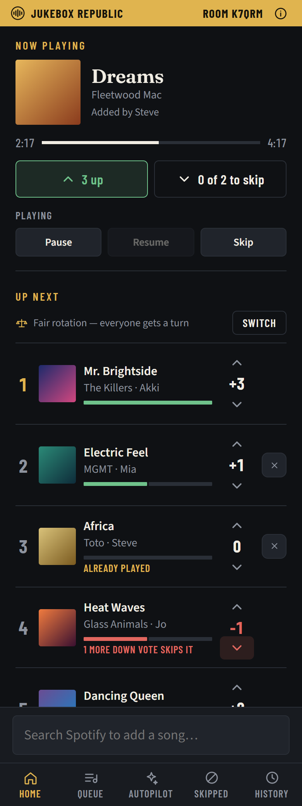
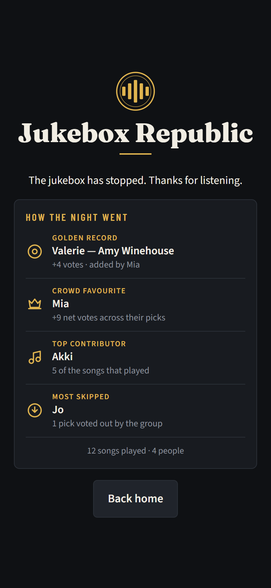

# Jukebox Republic

**The people's queue.** One person hosts through their Spotify account. Everyone else joins
from their own phone, adds songs and votes on what plays next. It's built for road trips and
house parties, anywhere one person usually ends up in charge of the music.

Live at **[music.pi.co.nz](https://music.pi.co.nz)**.

| Landing | Guest | Host | End of the night |
| --- | --- | --- | --- |
|  |  |  |  |

*Screens are from a sample session, with colour blocks standing in for album covers.*

## How it works

- **The host** logs in with Spotify once. Theirs is the only Spotify account the group needs,
  and the music plays on their device.
- **Guests** scan a QR code or type a room code, enter a name and they're in. No account, no app.
- **Everyone adds songs** by searching Spotify, and votes each song up or down.
- **Half the room can skip a song.** Once half the people connected (rounded up) vote it down,
  it's gone. It lands on a Skipped list, so anyone can bring it back.
- **The host keeps the final say.** Pause, resume and skip work whatever the vote says.

## What's in it

- **Two queue modes**, switchable mid-session. *Fair rotation* plays everyone's first pick before
  anyone's second, so nobody can flood the queue. *Majority rule* plays the most upvoted song
  next, with waiting songs slowly gaining ground so nothing gets stuck at the bottom.
- **Autopilot Mix** keeps the music going when the queue runs dry, from playlists the host picks.
- **Live vote tallies** on every queued song show what's popular and how close it is to a skip.
- **Co-hosts** can be given playback and moderation powers. The host can mark a guest as left, or
  remove and ban them.
- **Device picker** moves playback between the host's Spotify devices.
- **Duplicates** are allowed but flagged, and anyone can remove a flagged one.
- **History** can be saved as a Spotify playlist at the end of the night.
- **How the night went:** a closing card with the golden record, crowd favourite, top contributor
  and most skipped.

## Built for bad signal

The first version of this was for a car on roads with long dead zones, and that shaped the design:

- Everyone talks to a small server over their own mobile data, so nobody has to share a network.
  (Earlier attempts ran a Raspberry Pi hotspot in the car, and phones can't reliably hold a
  hotspot, Android Auto and a data connection all at once.)
- Phones reconnect by themselves after a dropout and carry on where they left off.
- A guest who loses signal or locks their phone still counts as present for 30 minutes, so the
  skip threshold doesn't jump around mid-song.
- Sessions are saved to Firestore, so a server restart or redeploy doesn't end anyone's night.
- If the host starts something by hand in Spotify, the app follows along and picks the queue back
  up when that song ends.

## Built with

Node.js 22, Express and Socket.IO on Cloud Run · Firestore for session persistence · Firebase
Hosting for the pages · the Spotify Web API. The front end is plain HTML, CSS and JavaScript
modules, with no build step.

## Running it locally

1. Create an app in the [Spotify Developer Dashboard](https://developer.spotify.com/dashboard) and
   add `http://127.0.0.1:8080/auth/callback` as a Redirect URI. The host needs **Spotify Premium**,
   because playback control doesn't work on Free.
2. Copy `.env.example` to `.env` and fill in the client ID and secret.
3. Install and run:

   ```
   npm install
   npm run dev
   ```

4. Open `http://127.0.0.1:8080` and press **Start spinning**.

Firestore is optional. Without `GOOGLE_APPLICATION_CREDENTIALS` or `FIRESTORE_PROJECT_ID` set,
sessions just live in memory. If you do point it at a real project, local sessions are saved
there too, so end them before deploying.

Run the tests with `npm test`.

## Releasing

```
node scripts/release.mjs patch
```

This bumps the version, stamps it into the pages and script imports so phones don't hold on to
old files, commits, pushes, tags and writes the GitHub release notes. Then deploy whichever side
changed:

```
gcloud run deploy jukebox-republic-server --source . --region australia-southeast1 --project jukebox-republic
firebase deploy --only hosting --project jukebox-republic
```

## Project layout

```
server/
  index.js              Express + Socket.IO entry point
  sockets.js            Real-time join, add, vote and host actions
  broadcast.js          Sends each phone its view of the session
  playbackEngine.js     Watches Spotify and moves the queue along
  queueFairness.js      The rotation and voting rules (start here)
  sessionStore.js       Session, guest and queue state
  persistence.js        Saves sessions to Firestore and restores them on boot
  autopilotMix.js       Fills the fallback mix from playlists
  sessionRecap.js       Works out the end-of-night awards
  goldenRecord.js       Finds the night's most upvoted song
  spotifyAuth.js        Host login and token refresh
  spotifyApi.js         Search and playback calls to Spotify
  routes/               HTTP routes for login, session info and search
public/
  index.html            Landing page
  host.html, guest.html The session screens
  js/queueApp.js        The shared queue UI
scripts/                Release and version stamping
```

## Limits

- **Spotify Development Mode** caps the app at 5 approved Spotify accounts, so hosting is
  invite-only. Guests aren't affected, because they never sign in to Spotify.
- **One server instance.** Live session state is held in memory, with Firestore as the backup, so
  the app is designed to run as a single instance.
- **Polling.** Spotify doesn't announce when a track ends, so the server checks every few seconds
  and starts the next song just before the current one finishes.

## License

Copyright 2026 Akki Bhat. Released under the
[PolyForm Noncommercial License 1.0.0](LICENSE): you're free to run, modify and share it for
personal, hobby, academic or other noncommercial purposes.

**Any commercial use needs a separate license.** Email license@pi.co.nz. Spotify's Developer Terms
also restrict commercial use of anything built on their API, so a commercial deployment would need
their agreement too.
